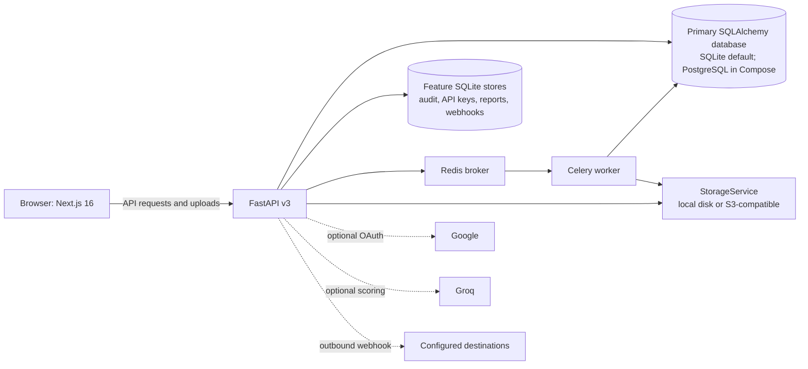

<div align="center">

```
 ██████╗██╗██████╗ ██╗  ██╗███████╗██████╗  █████╗
██╔════╝██║██╔══██╗██║  ██║██╔════╝██╔══██╗██╔══██╗
██║     ██║██████╔╝███████║█████╗  ██████╔╝███████║
██║     ██║██╔═══╝ ██╔══██║██╔══╝  ██╔══██╗██╔══██║
╚██████╗██║██║     ██║  ██║███████╗██║  ██║██║  ██║
 ╚═════╝╚═╝╚═╝     ╚═╝  ╚═╝╚══════╝╚═╝  ╚═╝╚═╝  ╚═╝
```

**Document PII detection and redaction with an API-backed review workflow.**

[](docs/PRODUCTION_REMEDIATION_ROADMAP.md)
[](#compliance)
[](https://nextjs.org)
[](https://fastapi.tiangolo.com)

---

*Aadhaar. PAN. GSTIN. Detect, review, and redact sensitive document data.*

[**v3 Documentation**](docs/README.md) · [**API Reference**](#api-reference) · [**Report a Bug**](#contributing)

</div>

---

## What is Ciphera?

Ciphera v3 is a document redaction application for individuals and teams. The Next.js browser client calls a FastAPI backend for analysis and document processing; uploaded content is sent to the backend configured for the deployment.

It detects and redacts **Personally Identifiable Information (PII)** such as Aadhaar, PAN, GSTIN, phone numbers, and email addresses. Storage, retention, and external data flows depend on deployment settings: the backend can use local or S3-compatible file storage, Google OAuth, optional external scoring, and outbound webhooks.

**Review your deployment's data flows, storage, and retention before processing sensitive documents.**

Ciphera includes privacy and audit features, but the software does not establish DPDP, GDPR, or ISO 27001 compliance. Those claims require legal review and controls in the deployed environment. See [security architecture](docs/CIPHERA_BACKEND_SECURITY_ARCHITECTURE.md) and the [production roadmap](docs/PRODUCTION_REMEDIATION_ROADMAP.md).

---

## Table of Contents

- [Why Ciphera](#why-ciphera)
- [Version Boundaries](#version-boundaries)
- [Features](#features)
- [Detection Pipeline](#detection-pipeline)
- [Architecture](#architecture)
- [Getting Started](#getting-started)
  - [Prerequisites](#prerequisites)
  - [Installation](#installation)
  - [Docker Deployment](#docker-deployment)
- [Usage](#usage)
  - [Single Document Redaction](#single-document-redaction)
  - [Batch Processing](#batch-processing)
  - [Visual Canvas Redaction](#visual-canvas-redaction)
  - [Synthetic Substitution](#synthetic-substitution)
- [API Reference](#api-reference)
- [Configuration](#configuration)
- [Supported PII Types](#supported-pii-types)
- [Compliance](#compliance)
- [Tech Stack](#tech-stack)
- [Contributing](#contributing)

---

## Why Ciphera

Every day, sensitive documents are shared via email, WhatsApp, cloud storage, and government portals — with PII fully exposed. Aadhaar numbers in job applications. PAN cards in rental agreements. Bank details in invoices. Medical records in insurance claims.

Existing solutions either:
- **Send your data to their cloud** — defeating the purpose of redaction
- **Require enterprise contracts** — inaccessible to individuals and small teams
- **Cover only Western PII formats** — missing Indian identifiers entirely
- **Offer manual redaction only** — slow, error-prone, inconsistent

Ciphera provides a workflow for detecting, reviewing, and redacting Indian and global PII formats. Detection is probabilistic; validate it against representative documents and measure false negatives before relying on it.

## Version Boundaries

`v3/` is the active application under development. Prototype directories are not intended as v3 code or runtime dependencies. The isolation audit is still open: `evaluate.py` currently adds the repository root to Python's import path. Treat the boundary as unverified until that path is removed and an isolated-checkout check passes. See the [roadmap item](docs/PRODUCTION_REMEDIATION_ROADMAP.md#execution-methods-for-the-six-open-high-priority-v3-items).

---

## Features

### Core Redaction
- **Automated PII Detection** — four-stage ensemble pipeline with confidence scoring
- **Indian PII Native Support** — Aadhaar (Verhoeff checksum), PAN, GSTIN, IFSC, Voter ID, Passport, Vehicle Registration
- **Global PII Coverage** — email, phone, dates, names, addresses, SSN, credit cards, URLs, IP addresses
- **Format-Aware Checks** — recognizers combine patterns and validation rules; they do not guarantee that every false positive is prevented

### Redaction Modes
- **Text Redaction** — replaces detected entities with typed placeholders `[AADHAAR_1]`
- **Visual Canvas Redaction** — pixel-level black bar redaction for PDFs and images
- **Synthetic Substitution** — generates replacement-like values; they are not guaranteed to be checksum-valid or suitable as real identity data
- **Selective Redaction** — human-in-the-loop review before any entity is removed

### Processing
- **Document Workflow** — upload, inspect detected entities, queue redaction, and download an artifact
- **Asynchronous Jobs** — Redis and Celery are used for the document redaction job path
- **Format Support** — supported formats depend on the route and parser; verify the current API contract before use

### Developer Tools
- **REST API** — route-specific JWT or API-key authentication; some routes still need an authorization review
- **Per-key Rate Limiting** — process-local limits currently protect API-key endpoints; they are not shared across replicas
- **Audit and Reports** — available, with persistence consolidation and release verification still in progress
- **Docker Compose** — local development stack; it is not a hardened production deployment

### Compliance & Security
- **Configurable Storage** — local disk by default, with an S3-compatible storage option
- **External Integrations** — Google OAuth, optional Groq scoring, and configured webhooks can make outbound requests
- **Security Remediation** — authentication, tenancy, retention, and deployment gaps are tracked in the production roadmap
- **Compliance Review Required** — the application is not certified and does not itself establish legal compliance

---

## Detection Pipeline

The following diagram describes the legacy text-analysis pipeline used by selected text routes. The authenticated document workflow has a separate canonical parser, detection service, and decision service; do not assume every route uses the same pipeline or threshold.

```
INPUT DOCUMENT
      │
      ▼
┌─────────────────────────────────────────────────────────┐
│ STAGE 01 — Regex Engine                   Weight: 1.4×  │
│ Format-aware pattern matching for structured Indian PII │
│ Aadhaar: Verhoeff checksum · PAN: alphanumeric struct   │
│ GSTIN: state code validation · IFSC: bank code verify   │
└─────────────────────────────────────────────────────────┘
      │
      ▼
┌─────────────────────────────────────────────────────────┐
│  STAGE 02 — Presidio NLP                   Weight: 1.0× │
│  Presidio analyzer with application recognizers         │
│  Handles unstructured text · Global PII patterns        │
│  Phone · Credit card · Email · SSN · Medical ID · URL   │
└─────────────────────────────────────────────────────────┘
      │
      ▼
┌─────────────────────────────────────────────────────────┐
│  STAGE 03 — spaCy NER                      Weight: 0.9× │
│  en_core_web_lg — context-aware named entity recognition│
│  Persons · Organisations · Locations · Dates            │
│  Understands surrounding text to prevent false positives│
└─────────────────────────────────────────────────────────┘
      │
      ▼
┌─────────────────────────────────────────────────────────┐
│  STAGE 04 — Voting Ensemble                     VERDICT │
│  Weighted score merge across all three engines          │
│  Type-lock at ≥0.80 regex confidence                    │
│  Prevents context reclassification of structured IDs    │
└─────────────────────────────────────────────────────────┘
      │
      ▼
REDACTED OUTPUT  ·  AUDIT LOG  ·  CONFIDENCE REPORT
```

**Confidence threshold:** The detector's default request threshold is **0.50**. The `0.80` value is used for a structured-entity type-lock rule; it is not a universal release threshold or a guarantee that uncertain results are always held for review. Validate the actual route and UI behavior before relying on it.

**Type-lock:** The pipeline includes a structured-entity type-lock threshold. Its behavior should be treated as an implementation detail and covered by regression tests for each supported entity type.

---

## Architecture



The browser sends requests and uploaded documents to the backend. Docker Compose includes PostgreSQL, Redis, the API, a worker, and the frontend. PostgreSQL serves the primary SQLAlchemy path, while several active feature modules still use separate SQLite stores. Optional providers and webhook destinations can receive data depending on configuration. This architecture is under remediation and is not production-ready; see the [current architecture and trust boundaries](docs/CIPHERA_BACKEND_SECURITY_ARCHITECTURE.md).

---

## Getting Started

### Prerequisites

```
Node.js          22 (frontend Docker image)
Python           3.11 (backend Docker image)
Docker           ≥ 24.0 (recommended)
Docker Compose   ≥ 2.0  (recommended)
```

For manual backend setup, also provide:
```
Redis             7 or compatible (Celery broker)
Tesseract OCR     English and Hindi language data
spaCy models      en_core_web_lg and xx_ent_wiki_sm
```

---

### Installation

**Option 1 — Docker Compose (Recommended)**

This starts the local development stack. It downloads container images and NLP model artifacts; the Compose file uses development credentials and publishes service ports, so do not treat it as a production deployment.

```bash
# Clone the repository
git clone https://github.com/Sibtain-Nayani/Ciphera.git
cd Ciphera/v3

# Copy environment template
cp .env.example .env

# Replace CIPHERA_JWT_SECRET and CIPHERA_REPORT_SIGNING_KEY with different
# randomly generated values before starting the services.
# Generate a value with: python -c "import secrets; print(secrets.token_hex(32))"

# Start all services
docker compose up --build
```

Ciphera will be available at `http://localhost:3000`

The first build downloads the pinned spaCy models and other build dependencies. Subsequent starts reuse cached images and volumes.

---

**Option 2 — Manual Installation**

**Backend:**
```bash
cd backend

# Create virtual environment
python -m venv .venv
source .venv/bin/activate          # Windows: .venv\Scripts\activate

# Install dependencies
pip install -r requirements.txt

# Create .env from .env.example and replace both signing-key placeholders.
cp .env.example .env

# Download spaCy model
python -m spacy download en_core_web_lg
python -m spacy download xx_ent_wiki_sm

# Set up database
python -m alembic upgrade head

# Start backend
python -m uvicorn main:app --host 127.0.0.1 --port 8000 --reload
```

**Frontend:**
```bash
cd frontend

# Install dependencies
npm ci

# Create .env.local with NEXT_PUBLIC_API_URL=http://127.0.0.1:8000

# Start development server
npm run dev
```

Frontend: `http://localhost:3000`
Backend API: `http://127.0.0.1:8000`
API Docs: `http://127.0.0.1:8000/docs`

---

### Docker Deployment

**Local Compose stack:**
```bash
# Start the configured development stack
docker compose up --build -d

# View logs
docker compose logs -f
```

**Environment variables:**

| Variable | Description | Default |
|---|---|---|
| `CIPHERA_JWT_SECRET` | JWT signing secret; required, random, at least 32 bytes | No default |
| `CIPHERA_REPORT_SIGNING_KEY` | Independent report signing key | No default |
| `DATABASE_URL` | Primary SQLAlchemy database URL | SQLite locally; Compose overrides with PostgreSQL |
| `CELERY_BROKER_URL` / `CELERY_RESULT_BACKEND` | Redis queue and result backend | `redis://localhost:6379/0` |
| `MAX_UPLOAD_SIZE_BYTES` | Upload size cap | `26214400` (25 MiB) |
| `MAX_PDF_PAGE_COUNT` | PDF page cap | `100` |
| `STORAGE_BACKEND` / `LOCAL_STORAGE_DIR` | File storage backend and local path | `local` / `./data/uploads` |
| `CORS_ORIGINS` | Allowed browser origins | See `.env.example` |
| `NEXT_PUBLIC_API_URL` | Frontend API URL; baked into the frontend image at build time | `http://localhost:8000` |

---

## Usage

The document API currently parses PDFs, supported raster images, and UTF-8 plain text. Only PDF currently has a verified server-side artifact release contract; attempts to queue image or text exports return `415 Unsupported Media Type`. The Batch page can stage TXT, CSV, JSON, Markdown, and DOCX files, but secure batch processing and downloads are temporarily disabled because the previous browser-only redaction path bypassed the server verification gate. Unknown formats and invalid UTF-8 text uploads are rejected with `415` before storage. Use synthetic documents until format-specific verification and release gates are complete.

### Single Document Redaction

1. Navigate to **Redact** in the sidebar
2. Upload a PDF for verified export. Raster images and plain text can be parsed for review, but their exports are currently blocked until a format-specific verifier is implemented.
3. The backend parses the file and runs its document detection and decision services
4. Detected entities are highlighted with their type and confidence score
5. Review detections — approve, reject, or modify any entity
6. Click **Redact** to apply
7. Download the artifact only when the job reports a completed, verified state; jobs requiring review must not be treated as releasable

Each release job stores hashes for its source bytes, reviewed entity snapshot, versioned policy, and verified output. The download route rechecks that document state is unchanged and verifies the stored PDF checksum before returning the bytes. Downloads currently pass through the API for both local and S3 storage.

**Document API inputs:** PDF, images accepted by the image parser, and plain text. Only `application/pdf` files ending in `.pdf` can enter the verified export workflow. Password-protected PDFs are rejected. Other formats are not guaranteed to parse or redact safely.

**Batch page inputs:** TXT, CSV, JSON, MD, DOCX can be staged. PDF and images are directed to the Redact page. The Batch page currently rejects processing requests with guidance to use the verified single-document workflow; no batch exports are available.

---

### Batch Processing

The Batch page is present in the UI, but processing is temporarily disabled. The prior browser-side path could generate downloadable output without the server's independent verifier. Use the Redact workspace for each document until the backend supports a verified batch job flow. Do not use earlier batch-generated artifacts as evidence of verification.

---

### Visual Canvas Redaction

For PDFs and images where text extraction is unreliable (scanned documents, complex layouts):

1. Open a document in the **Redact** page
2. Switch to **Canvas Mode**
3. Detected text regions are highlighted automatically
4. Draw additional redaction boxes manually over any area
5. Black bars are applied at the pixel level
6. Export the result only after independently checking the artifact. The current release-verification gate is not complete for every format and route.

The backend uses Tesseract OCR on supported image/scanned-document paths. OCR coverage and redaction geometry must be validated against representative files; a successful export is not by itself proof that all sensitive content was removed.

---

### Synthetic Substitution

The `/api/v3/synthesize` endpoint returns replacement-like values for supported entity types. It is not a secure anonymization guarantee and currently has no route-level authentication.

- Aadhaar numbers → 12-digit format-like value (not Verhoeff-validated)
- PAN → Valid format fake PAN
- Names → Common Indian names from a local dataset
- Phone numbers → Valid Indian mobile number patterns
- URLs and IP addresses → Placeholder-like values for supported types

The response includes original values in its `substitutions` array. Treat inputs and outputs as sensitive; use this endpoint only on a trusted local development instance until authentication and output handling are fixed.

The UI's substitution preferences are not guaranteed to be enforced consistently by every backend route.

---

## API Reference

Authentication is route-specific. `/api/v3/public/redact` and `/api/v3/public/analyze` require an API key in `X-API-Key`; account and document routes use JWT bearer tokens. Other mounted routes do not all enforce authentication. In particular, `/api/v3/analyze`, `/api/v3/synthesize`, and `/api/v3/classify` currently lack route-level auth dependencies. Keep the API private until the route-security review is complete. The generated OpenAPI document at `/openapi.json` is the source for current request and response schemas.

Keys can be managed in **Settings → API Keys**. API-key storage currently uses a separate SQLite feature store and is not ready for a production multi-replica deployment.

---

### `POST /api/v3/public/redact`

**Deprecated; currently returns `410 Gone`.** This stateless endpoint returned redacted text without independent output verification or a versioned release policy. Use the authenticated document upload, async redaction, status, and verified download workflow instead. The route remains in the API schema so existing clients receive a clear deprecation response.

---

### `POST /api/v3/public/analyze`

Detect entities without redacting. Returns detection report only.

```bash
curl -X POST http://localhost:8000/api/v3/public/analyze \
  -H "X-API-Key: ck_live_..." \
  -H "Content-Type: application/json" \
  -d '{"text": "Call me at +91 98765 43210"}'
```

---

### `POST /api/v3/synthesize`

Replace PII with synthetic Indian data instead of placeholders.

**Authorization status:** this route currently has no route-level auth dependency. Do not expose it to untrusted callers. Its response includes original values in a `substitutions` array; treat both request and response as sensitive. Generated values are not guaranteed to pass identity checksums or be safe to use as real identity data.

```bash
curl -X POST http://localhost:8000/api/v3/synthesize \
  -H "Content-Type: application/json" \
  -d '{"text": "Name: Priya Sharma, Phone: +91 98765 43210"}'
```

---

### `POST /api/v3/classify`

Classify text and return a document-type estimate. The route accepts JSON text, not a file upload.

**Authorization status:** this route currently has no route-level auth dependency. Keep it on a trusted local development instance until route authentication is implemented.

```bash
curl -X POST http://localhost:8000/api/v3/classify \
  -H "Content-Type: application/json" \
  -d '{"text":"Invoice number 123, total amount 5000", "filename":"invoice.txt"}'
```

---

### Rate Limiting

| Plan | Requests/minute | Max file size |
|---|---|---|
| Default API key | 60 requests/minute | N/A for text API |
| API key setting | 1–1000 requests/minute | N/A |

The API-key limiter is process-local memory. It is not coordinated across replicas, and the current implementation does not promise rate-limit response headers. The document upload route has a separate 25 MiB default cap.

---

## Configuration

### Detection Engine

The settings screen exposes client preferences and redaction options; not every setting is enforced consistently by every backend route. Treat the active API schema and implementation as authoritative:

| Entity Type | Available Actions |
|---|---|
| Names | Redact · Substitute · Ignore |
| Aadhaar | Redact · Partial mask (last 4 visible) · Substitute |
| PAN | Redact · Substitute · Ignore |
| Phone | Redact · Partial mask · Substitute |
| Email | Redact · Domain-only mask · Substitute |
| Date of Birth | Redact · Year-only · Substitute |
| Bank Account | Redact · Last 4 visible · Substitute |
| GSTIN | Redact · Substitute · Ignore |
| IFSC | Redact · Substitute · Ignore |
| Voter ID | Redact · Substitute |
| Passport | Redact · Substitute |
| Address | Redact · Substitute · City-only |

### Confidence Threshold

The English pipeline's default request threshold is `0.50`; the Hindi pipeline uses `0.48`. The `0.80` constant is a structured-entity type-lock threshold, not the default redaction threshold.

The text analysis request accepts `threshold` as a request field:
```json
{
  "text": "...",
  "threshold": 0.50
}
```

---

## Supported PII Types

### Indian PII

| Type | Validation Method | Example |
|---|---|---|
| Aadhaar | Pattern and pipeline validation; confirm the active route behavior | `4532 8812 9901` |
| PAN | Alphanumeric structure + format | `ABCPD1234E` |
| GSTIN | Pattern-based structural checks | `27AADCB2230M1ZP` |
| IFSC | Bank code + branch regex | `SBIN0001234` |
| Voter ID | State prefix + alphanumeric | `ABC1234567` |
| Passport | Pattern-based format check | `A1234567` |
| Vehicle Reg | State code + district + serial | `MH12AB1234` |
| Driving Licence | State + RTO + format | `MH0120110012345` |

### Global PII

| Category | Types Covered |
|---|---|
| Contact | Phone (Indian + international), Email, URL |
| Identity | Names (person, organisation), SSN/TIN |
| Financial | Credit/debit card, Bank account, SWIFT/BIC |
| Medical | Medical licence, NPI, Health ID |
| Digital | IP address, MAC address, Device ID |
| Temporal | Date of birth, Age, Dates in context |
| Location | Address, Coordinates, Postcode |

The `GET /api/v3/entities` route lists entity names exposed by the primary API. Actual recognition coverage varies by route and language; treat this list as capability intent, not a guarantee of detection.

---

## Compliance

### DPDP Act 2023 (Digital Personal Data Protection Act)

Ciphera is not certified as DPDP-compliant. The operator must establish lawful purpose, notice/consent where applicable, retention, deletion, processor controls, incident handling, and any required localisation for the selected deployment. The application currently sends files to its configured backend and may use optional external services.

### GDPR (General Data Protection Regulation)

Ciphera is not certified or represented as GDPR-compliant. Data-controller and processor obligations, lawful basis, retention, deletion, and security controls must be assessed for the deployment. Documents are sent to the configured backend; optional external providers may receive data.

### ISO 27001

Ciphera has not been audited or certified against ISO 27001. Its current controls do not replace an information security management system or an independent audit.

### Audit Logs

Audit fields depend on the route and feature. The example below is illustrative only; it is not an API schema or evidence that every field is captured or immutable:

```json
{
  "session_id": "RUN-5130",
  "timestamp": "2026-05-25T18:59:05Z",
  "document_hash": "sha256:a3f9...",
  "entities_detected": 25,
  "entities_redacted": 25,
  "pipeline_version": "3.0.0",
  "confidence_threshold": 0.80,
  "processing_ms": 1243,
  "integrity_hash": "sha256:9d2c..."
}
```

Audit and report features currently use separate SQLite persistence in parts of the application. They are not a complete immutable ledger and do not by themselves satisfy regulatory audit requirements.

---

## Tech Stack

### Frontend
| Technology | Version | Purpose |
|---|---|---|
| Next.js | 16.2.2 | React framework, App Router |
| React | 19.2.4 | UI library |
| TypeScript | 5.x | Type checking |
| Tailwind CSS | 4.x | Styling |

### Backend
| Technology | Version | Purpose |
|---|---|---|
| FastAPI | 0.115.0 | REST API framework |
| Python | 3.11 | Runtime in the backend image |
| Presidio Analyzer | 2.2.354 | PII analysis framework |
| spaCy | 3.7.4 | NLP runtime |
| en_core_web_lg | 3.7.1 | English NLP model |
| Tesseract OCR | OS package | Image/PDF text extraction; version depends on base image |
| PyMuPDF | 1.24.9 | PDF processing |
| SQLAlchemy | 2.0.35 | Primary ORM persistence path |
| Alembic | 1.13.3 | Primary ORM migrations |

### Infrastructure
| Technology | Purpose |
|---|---|
| Docker Compose | Local stack for frontend, API, worker, PostgreSQL, and Redis |
| PostgreSQL 15 | Primary SQLAlchemy database in Compose; Supabase migration is not complete |
| SQLite | Default primary ORM database and separate active feature stores |
| Redis 7 | Celery broker and result backend |
| Local / S3-compatible storage | Document storage options; local storage is the default |

---


## Contributing

Ciphera is open source. Contributions are welcome — especially for:

- **New Indian PII recognisers** — Driving licence formats, ration card, etc.
- **Language support** — Hindi, Tamil, Telugu, Bengali document support
- **Performance improvements** — Pipeline latency reduction
- **Bug reports** — Open an issue with steps to reproduce

**Before contributing:**

```bash
# Fork the repository
# Create a feature branch
git checkout -b feat/your-feature-name

# Make your changes
# Backend tests (install the full backend requirements first)
cd backend && python -m pytest tests -q

# Frontend static checks (there is no npm test script yet)
cd frontend && npm ci && npm run lint && npx tsc --noEmit

# Submit a pull request
```

**Coding standards:** Follow [CONTRIBUTING.md](CONTRIBUTING.md). Use synthetic test fixtures rather than real personal data. Detection changes need positive and negative cases plus regression evidence.

---

## Roadmap

The checkmarks below mean implementation work exists in the codebase; they do not indicate production readiness. Current release blockers and their verification gates are tracked in the [production remediation roadmap](docs/PRODUCTION_REMEDIATION_ROADMAP.md).

- [x] **v3 feature work present** — bilingual analysis, accounts, organizations, API keys, signed reports, and webhooks; several features still have security or persistence gaps
- [ ] **v3 launch gate** — close the P0 security, release verification, resource-limit, dependency, and deployment findings
- [ ] **v3 data platform** — consolidate feature stores and complete the PostgreSQL/Supabase migration with verified tenant isolation
- [ ] **v3 operations** — establish CI release gates, observability, backup/restore, and production load evidence
- [ ] **Future product work** — CLI, browser extension, and additional on-device inference after launch blockers are closed

---


<div align="center">

*Browser requests and uploaded documents are sent to the configured backend.*
*Storage and retention depend on deployment configuration and cleanup controls.*

---

```
> REVIEW DATA FLOWS · STORAGE · RETENTION
```

</div>
