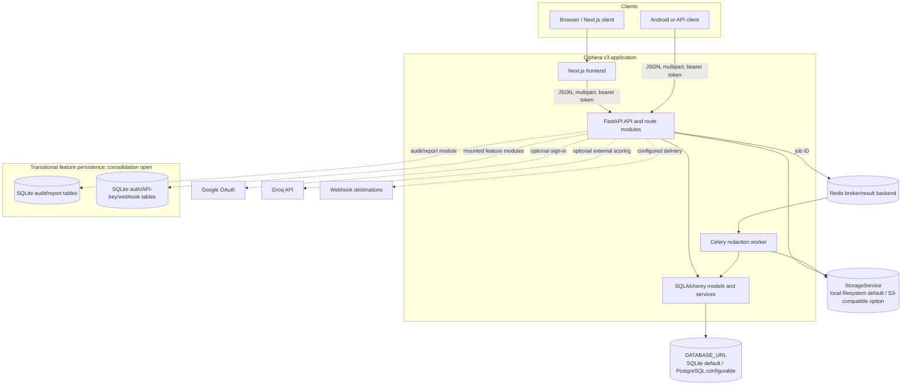
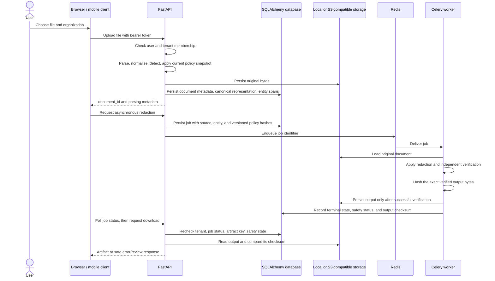
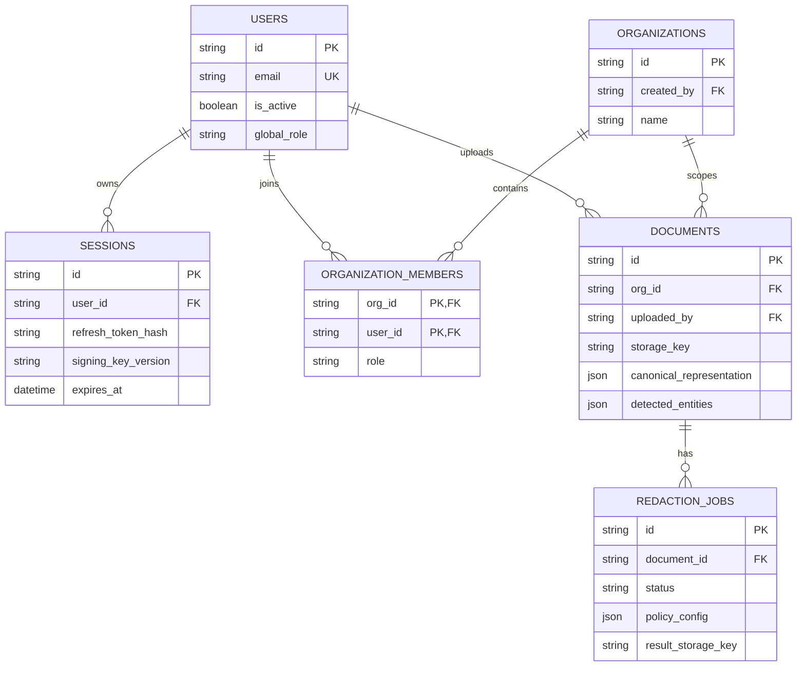
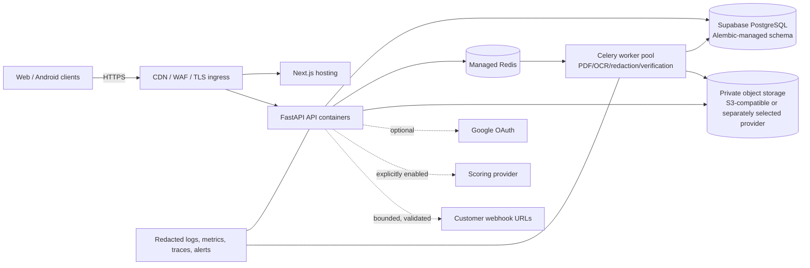

# Ciphera v3 architecture and security model

**Status:** Current source review and target design
**Reviewed:** 2026-11-04
**Scope:** v3 runtime, data paths, security boundaries, and production direction

This document distinguishes the implementation in the current repository from the proposed production architecture. Diagrams are descriptive, not proof of runtime behavior. The [production roadmap](PRODUCTION_REMEDIATION_ROADMAP.md) is the release gate and records verification status.

## 1. System context

Ciphera accepts text and documents, detects candidate sensitive spans, applies a policy snapshot, and can create asynchronous redaction jobs. The API is implemented in FastAPI; the web client is Next.js; Celery workers perform asynchronous redaction and verification. The system persists document metadata and may persist original document bytes, canonical text, detected spans, reports, and audit data.

The current implementation is pre-production. It is not client-only, zero-retention, or certified for DPDP, GDPR, ISO 27001, or other standards. Do not use real customer data until open P0 findings are closed and the deployment's data processing and retention controls have been reviewed.

## 2. Current runtime architecture

### Component responsibilities

| Component | Responsibility | Current limitation |
|---|---|---|
| Next.js client | Login and account UI, document upload/review flows, API calls | Browser tokens are stored in `localStorage`; refresh is single-flight and synchronized across tabs, but cookie-based refresh remains a launch decision |
| FastAPI | Auth, tenant/org checks, document routes, analysis, audit/report, integrations | `GET /api/v3/health` does not check DB, Redis, worker, or object-storage readiness |
| SQLAlchemy | Primary relational identity, membership, document, and job data | `DATABASE_URL` defaults to SQLite; feature modules still use direct SQLite persistence |
| Celery + Redis | Queue long-running redaction work outside the HTTP request | Retry/idempotency, resource isolation, and durable dispatch need more work |
| `StorageService` | Local or S3-compatible original/artifact storage | No retention lifecycle is configured; S3 mode is not the same as a Supabase Storage integration |
| Detection/verification services | Parse, detect, apply decisions, redact, and verify output | Verified artifact release is PDF-only; format-specific gates and adversarial failure coverage remain open |
| Optional integrations | Google OAuth, Groq scoring, outbound webhooks | External data flows and outbound destination controls must be reviewed before enablement |

## 3. Data lifecycle and trust boundaries

### Data that can be persisted

- Identity and session metadata in the SQLAlchemy database; OAuth state and provider configuration have separate implementation details.
- Uploaded original file bytes under the configured storage backend.
- Canonical document representation, which can include extracted text and page metadata.
- Detected entity spans and user-edited entity decisions.
- Redaction job status, immutable source/entity/policy snapshots and hashes, verified output checksum, error summary, and output object key.
- Audit rows and report manifests/signatures in SQLite feature stores.
- API-key and webhook configuration/delivery records in legacy SQLite paths.

No general retention scheduler or complete delete workflow is documented as implemented. Data can outlive the browser session and API process. Define retention and deletion across relational rows, originals, derived text/entities, outputs, object versions, backups, and audit records before launch.

### Current relational schema

This diagram covers SQLAlchemy models only. It excludes SQLite-managed `audit_logs`, `report_ledger`, API-key, webhook, and legacy-auth tables. Those must be inventoried and migrated or retired before claiming one canonical schema.

## 4. Authorization and release controls

### Implemented in the current source

- Password login and registration issue JWTs; access tokens carry an issuer, audience, purpose, session ID, expiry, and signing-key version.
- The primary auth dependency checks user active state and a matching live session row.
- Document reads, edits, job status, and downloads resolve the document's organization membership; unknown or unauthorized documents are returned as not found.
- The old shared `default-org` path is quarantined; uploads without a selected organization resolve to a user's private organization.
- Report generation uses server-side completed/verified jobs and actual artifact bytes, plus a distinct report HMAC key and ordered report ledger.
- Asynchronous output is stored under a redacted key only after verification; the download route checks completion, safety state, and the checksum of the stored bytes before returning them.

These source controls have targeted regression coverage. Refresh rotation/reuse detection, login rate limiting, password bounds, and frontend refresh synchronization have passed focused SQLite/PostgreSQL, Redis, and frontend checks. Browser tokens are still stored in localStorage; the browser token-storage decision remains open before launch.

### Release-gate gaps

- The legacy synchronous document export, standalone PDF export, direct image artifact routes, and API-key text-redaction output now return `410 Gone`; face lookup returns coordinates only for submission into the canonical document-job flow. The browser-only batch export UI and its local artifact generators have been removed.
- Verified exports currently accept only `.pdf` + `application/pdf`; the async route rejects other formats and the worker quarantines legacy unsupported jobs. Image and text exports need independent verifiers before they can be enabled.
- Each job stores source key/hash, entity snapshot/hash, versioned policy/hash, and a checksum of the verified output. The worker checks source/entity/policy state before reading storage; the download route rejects stale document state and returns bytes only when the output checksum matches. Complete failure-injection/adversarial PDF coverage before treating the release flow as complete.
- Upload parsing rejects unknown formats and invalid UTF-8 plain text with `415` before storage. Image decoder/resource limits and additional text-format support still need explicit format contracts.
- The public text-analysis endpoint can return original entity text/context and currently has no auth dependency.
- Webhook URL validation must protect against private IPs, redirects, DNS rebinding, and metadata endpoints on every delivery.
- API-key and webhook routes are mounted but not yet integrated with the canonical SQLAlchemy identity and database.

## 5. Threat model and controls

| Threat | Current control | Remaining work |
|---|---|---|
| Cross-tenant document/job access | Organization membership is checked for primary document routes; regression cases exist | Test every mounted route and Supabase RLS policy; bind all artifact/audit/API-key paths to the same identity |
| Stolen or replayed token | Short-lived session-bound access token; signing-key version; atomic refresh rotation/reuse detection and rate limits | Move browser refresh credentials out of localStorage; continue route-contract checks |
| Malformed or oversized upload | Byte and PDF page limits; PDF-only verified release gate | Streaming ingress caps, image pixel/dimension limits, decompression/time budgets, reject unknown types at ingress, worker resource quotas |
| PII leakage or artifact substitution | Async verifier, immutable input snapshots, and output checksum validation before download | One release service across every export path; fail-closed format matrix; failure-injection and adversarial tests |
| SSRF through webhook | HMAC-signed delivery payload | URL parser/resolver policy, private/link-local/metadata blocks, redirect rejection, timeout and durable retry controls |
| Secret leakage | No weak JWT fallback; separate JWT/report keys; env files excluded | Validate deployment secret injection, rotate known material, secret scanning and runtime key lifecycle |
| Dependency exploit | Pinned direct dependencies in `requirements.txt` and npm lockfile | SCA, transitive lock/patch process, SBOM, base image patching, build provenance |
| Service interruption/data loss | Relational migration history and Compose volumes exist | Managed durable storage, backup/restore drills, queue idempotency, DB/worker readiness, SLOs/alerts |

## 6. Target deployment architecture

The first production target should keep FastAPI as the authorization/business-logic boundary, move the complete relational schema to Supabase PostgreSQL, and keep OCR/redaction in long-running API and worker containers. Avoid using Supabase Edge Functions for large PDF/OCR jobs. Choose exactly one identity authority; do not dual-write custom SQLAlchemy users and Supabase Auth users.

### Supabase PostgreSQL migration sequence

1. Inventory every SQLAlchemy and SQLite table, local file, identity join, audit record, and retention requirement. Decide which feature routes are supported and which are retired.
2. Make the SQLAlchemy/Alembic schema canonical. Add explicit PostgreSQL types, foreign keys, unique constraints, tenant indexes, and UTC timestamp semantics; remove SQLite-only runtime schema bootstraps from mounted features.
3. Choose whether FastAPI JWT identity remains authoritative for the first launch or whether a separate Supabase Auth migration is justified. Do not accept two token authorities accidentally.
4. Create separate least-privilege runtime and migration credentials. Never put Supabase secret/service-role keys or database credentials in browser variables. Supabase documents that secret/service-role credentials bypass RLS; keep them server-side and restrict their use.
5. Decide tenant enforcement: API authorization plus PostgreSQL RLS as defense in depth. If using custom FastAPI auth, establish authenticated tenant context inside each transaction; use a role that cannot bypass RLS. Test connection-pool context reset so one request cannot inherit another tenant's identity.
6. Add RLS policies and positive/negative SQL tests in the same migration set before exposing any table through the Supabase Data API. Revoke broad grants as needed; policies alone do not remove table grants.
7. Use the Supabase dashboard's connection details. For persistent API/worker containers, use a direct connection when networking supports it or a session pooler for compatibility; transaction pool mode is primarily for short-lived/serverless connections and has session-feature limitations. Set SQLAlchemy pool sizes across all API and worker replicas.
8. Migrate from a reviewed snapshot: back up, run a dry migration, reconcile source/destination counts and checksums, validate tenant ownership, then cut over with rollback/restore steps. Never infer ownership for old shared-organization records.
9. Rehearse failover, backup restoration, credential rotation, migration rollback/recovery, queue retry, and object-store recovery in staging.

Supabase references: [database connections](https://supabase.com/docs/guides/database/connecting-to-postgres), [pooling and connection limits](https://supabase.com/docs/guides/database/connecting-to-postgres/pooling-and-limits), [row-level security](https://supabase.com/docs/guides/database/postgres/row-level-security), and [secure data](https://supabase.com/docs/guides/database/secure-data).

### Hosting profiles

| Profile | Topology | Fit and constraints |
|---|---|---|
| Managed pilot (recommended) | Next.js hosting; managed container service for FastAPI and Celery; Supabase PostgreSQL; managed Redis; private object storage | Low operations burden while retaining durable workers. Confirm worker CPU/memory/runtime limits, private egress, pooler mode, and backups. |
| Container platform | AWS ECS/Fargate or equivalent; managed Postgres, Redis, object storage, CDN/WAF | Strong network, IAM, and scaling controls; more infrastructure and operational work. Separate API and worker services and keep DB/Redis private. |
| Private VPS pilot | Docker Compose behind Caddy/Nginx; managed PostgreSQL and object storage | Suitable only for a controlled pilot with a named operator, patch/backup plan, private service ports, monitoring, and restore drills. The checked-in Compose files are not production-ready as written. |

The system needs long-running workers and CPU/memory isolation for PDF/OCR workloads; do not move the core redaction pipeline to short-lived edge functions.

## 7. Minimum CI/CD release gates

The repository does not yet have a complete root release workflow. Add a workflow that builds only v3 and runs these stages:

1. Clean checkout and enforce a dependency-boundary check that fails if v3 imports or loads files from `Ciphera/` or `CipheraV2/`.
2. Install locked Python and npm dependencies; run format/lint/type checks without ignored errors.
3. Run unit, auth/tenant, format/security, migration, worker-failure, and API contract tests on disposable SQLite plus PostgreSQL.
4. Run dependency scanning and secret scanning; publish an SBOM and fail critical/high unresolved findings unless a reviewed exception exists.
5. Build frontend/backend/worker immutable images from `v3/`; scan images and test health/readiness endpoints.
6. Deploy to staging, apply migrations as a one-off job, run smoke and tenant-isolation checks, and require an approval gate before production.
7. Record image digest, migration revision, release metadata, backup/restore status, and rollback target.

## 8. Operational signals and targets

Start with pilot SLOs that are measurable and safe to revise:

- API availability and latency by route class; 5xx rate and auth rejection anomalies.
- Upload byte/page limits, queue depth/oldest job age, job duration, review/failure ratio, verifier rejection count.
- Database connection saturation, slow queries, migration status, Redis availability, object-storage failures.
- No sensitive payloads in logs. Include correlation IDs, tenant/user IDs only where access-controlled and privacy-reviewed, job IDs, and sanitized error classes.
- Define backup RPO/RTO and prove a restore into an isolated environment before production.

The roadmap's current target scores are Security 8/10, Reliability/observability 7/10, Scalability 6–7/10 for pilot, Code quality 7/10, and Test coverage 7/10 with at least 80% on core auth, document lifecycle, and redaction decision logic. These are targets, not measured current scores.
